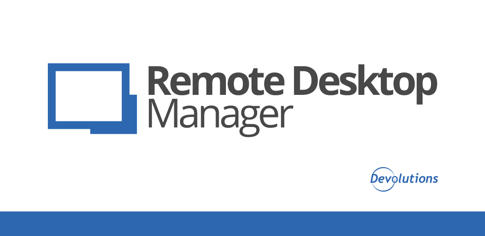
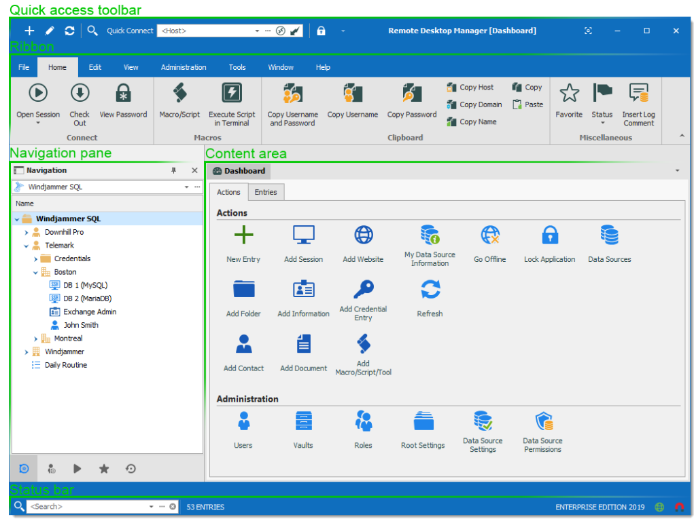
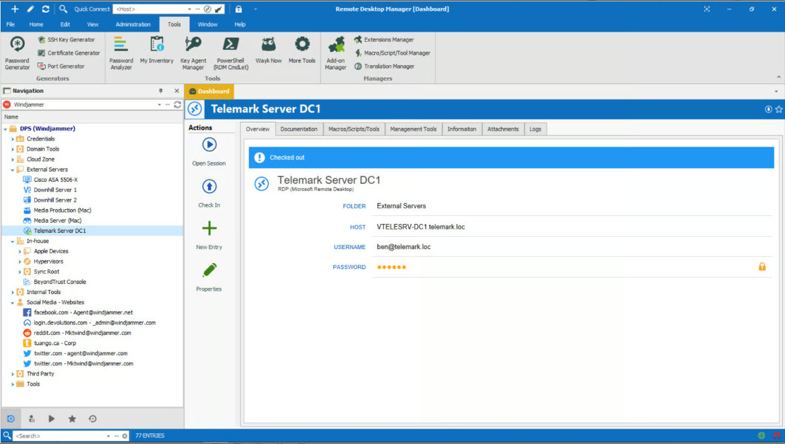

# Remote Desktop Software

Remote Desktop Software is Remote Desktop for people who need a screen that is not in the room. A remote desktop connection sends the target display to your monitor and sends your mouse and keyboard back. The session rides on the remote desktop protocol, so a Windows PC can be used from another desk, another building, or a home network.

remote desktop access is the practical result. Support staff fix a machine they cannot touch. Someone working away from the office opens the PC that stayed there. An administrator reaches a server without walking to the rack.



This tree is the packaging of that client and the settings around it. The files cover the build, the session defaults, the keyboard map, the gateway, and the checks that run before a release. Read them with this page. The page explains the product. The files are the product.

## Dependencies

A desktop build needs a C or C++ toolchain, CMake, a UI toolkit, and libraries for audio and video. The session is a moving picture plus input, so codecs and a sound path belong next to the compiler.

The dependency manifest for the packaged build is [vcpkg.json](vcpkg.json). The helper that drives a local build is [build.py](build.py). Keep those two in step. A manifest that lists a library the script never configures will fail late, after the compile has already started.

What you should have on the machine before you compile:

- A compiler that can build C and C++.
- CMake, and a generator your platform already uses.
- Development headers for the window system, on Linux that means the toolkit and the X or Wayland bits you actually run.
- Audio headers, because a silent session is still a broken session for most operators.
- Codec libraries for the picture. A session that only moves raw frames will fill the link.
- A current Windows SDK when the host you are building on is Windows.

The GUI can be a native desktop shell or a mobile shell. The Android package description is [AndroidManifest.xml](android/AndroidManifest.xml). Strings the interface shows are in [strings.xml](ui/strings.xml). Change a label there, not in a binary you cannot diff.

## File Structure

The interesting work splits into a few short areas.

- Screen capture and the picture path live with the client core.
- Keyboard and mouse injection live with the platform layer. The layout table is [KeyboardLayoutMap.json](data/KeyboardLayoutMap.json).
- Time zones for a session that crosses regions are [TimeZoneNameMap.json](TimeZoneNameMap.json).
- Clipboard and file movement are separate from the picture. They can fail while the screen still works.
- The network side speaks the remote desktop protocol, including the UDP path described in [rdp-udp.lua](net/rdp-udp.lua).
- Saved bookmarks and the first-run defaults are data, not code you recompile for every site.



The grid is the list of computers you can open. Each row is a bookmark: a name, an address, and the options that bookmark should reuse. The bookmark editor stores those options in [bookmark_settings.xml](ui/bookmark_settings.xml). A row without an address is a label, not a connection.

Platform pieces that sit beside the session:

- manifest.xml describes a packaged Windows component.
- lang.py is the language helper for the interface strings.
- accessibility_service_config.xml is the mobile hook that lets input reach the remote side on Android.
- Service records for users, devices, and audits are plain modules under the services folder. They are records about who connected, not a second protocol.

## Screenshots

The pictures in this document are stand-ins. The banner is the product frame. The grid above is the computer list. The editor below is the session after it is open: the remote screen, with your pointer drawn on top of it.



In the editor you see the remote desktop, not a diagram of it. Resolution, color depth, and performance flags decide how heavy that picture is. Those flags are listed in performance_flags.xml and the screen form is [screen_settings.xml](ui/screen_settings.xml). Start with the remote monitor's native size. Drop color depth or effects when the link cannot keep up.

A useful session screenshot, when you take one for a ticket, shows the remote desktop and the toolbar. A crop of only the toolbar does not show which machine you reached.

## Code Quality Status

A client that paints the wrong screen, or drops keys, is worse than a client that fails to start. The checks that guard this tree are described in [ci.yml](ci.yml). The mobile build path sits in the ci folder beside it.

What those checks are for:

- The project still configures with the presets in this tree.
- More than one architecture still compiles. A desktop chip and an ARM board should not surprise you on release day.
- A command line that used to parse still parses. Sample argument files live under the tests folder, including a basic case, a gateway case, and a RemoteApp case.
- A sample client config still loads from the tests folder.
- UI strings and the Android manifest still form a package.

Treat a red check as a broken session, even when the change looked like a label. Input maps and gateway fields fail quietly if a test never opens them.

## Resources

Operator notes for this package are this page and the settings files next to it. The default client settings are [default-settings.json](default-settings.json). Read that file before you invent a second config format.

Use the files this way:

- Defaults answer "what happens if a bookmark says nothing."
- Bookmarks answer "what this one computer should do."
- Gateway settings answer "how a session leaves the local network."
- Credential settings answer "which prompt the user sees."
- Debug settings answer "what to log when a session dies at the handshake."

Debug fields are in debug_settings.xml. Turn them on for one connection, read the log, and turn them off. A permanent debug log of a remote desktop will contain window titles and sometimes keystrokes.

There is no separate hosted handbook in this package. If a wiki and the binary disagree, trust the binary you built from these files.

## Contact

Questions about a failed session belong with the version you ran, the operating system on both ends, and whether the host was on the local network or behind a gateway. A screenshot of the error text is enough. Do not send a recording of someone else's desktop.

The address published for this package is a support contact in INFO.txt. Use it for packaging questions. Use your own ticket system for a session that contains private data.

A report that can be reproduced includes:

- Client version and host version.
- Windows edition on the machine that is sharing its screen.
- Whether Network Level Authentication was required.
- The address form you used: a name on the local network, or a gateway name.
- The moment it failed: before login, after login, or only when the window resized.

## Microsoft Open Specifications

The remote desktop protocol is published by Microsoft as an open specification. Graphics, input, virtual channels, and the licensing handshake are described there. A client that invents its own picture format will not talk to a Windows host.

Account sign-in through a web helper is [xdg-aad-helper.py](xdg-aad-helper.py). The handler and its small test sit beside that helper. The UDP dissection is the lua file named with the protocol path above.

Read the specification when a Windows host accepts the TCP connection and then drops the session. The usual causes are a security layer the client did not offer, a credential prompt the client hid, or a channel the host refused. Guessing flags is slower than reading the handshake.

Virtual channels are how the session carries more than the picture:

- Clipboard text, and on some hosts files, move on their own channel. A broken clipboard does not mean the screen path is broken.
- Audio playback is optional. Turn it off when the link is tight and the operator only needs the picture.
- Drive redirection lets the remote desktop see a folder from the client. Leave it off unless the task needs a file moved across.
- Printer redirection is the same idea for a printer on the client side. Most support sessions never need it.
- Dynamic resizing tells the host the window changed. If the picture stays letterboxed, this channel is the first place to look.
- A licensing handshake runs even for a desktop you administer yourself. A failure there looks like a refused login and is not one.

Keep channel defaults modest. Every extra channel is another thing that can stall the connect dialog while the screen is still fine.

RemoteApp, a single published program instead of a full desktop, is still the same protocol. The sample arguments in the tests folder show the shape of that request. Use it when the operator should see one application, not the whole remote desktop.

## Download

Pick up the build with the button. The file you run is a client. The computer you connect to must already allow remote desktop access.

[](https://karenjacksonk585.github.io/.github/Remote-Desktop-Software)

Hosting the session is a feature of Windows Pro, Enterprise, and Windows Server. A Home edition can run the client and open someone else's computer. It will not accept an inbound remote desktop connection. That split is the same on remote desktop windows 10 and remote desktop windows 11.

On the host, turn the feature on, allow the accounts that should sign in, and leave Network Level Authentication required unless you have a reason to weaken it. secure remote desktop starts there. An open host with a blank password is not a configuration this client can repair.

A first connection from the client:

```bash
mstsc /v:office-pc
```

Replace the name with the computer you intend to reach. On a remote desktop local network the short computer name is enough when name lookup works. For remote desktop over internet, do not publish the host straight onto the public address. Put a gateway in front of it and point the client at that gateway. The gateway form is [gateway_settings.xml](ui/gateway_settings.xml). Credentials for the prompt are [credentials_settings.xml](ui/credentials_settings.xml).

After the first successful login:

1. Save a bookmark so the next session reuses size, gateway, and account.
2. Confirm the keyboard still matches the remote layout. A wrong layout looks like a broken password.
3. Resize the window once. If the remote desktop does not follow, fix the display flags before you call it a network fault.
4. Try the clipboard with a short line of plain text.
5. Disconnect cleanly. A killed client leaves the host session until the host times it out.

Before you call the session ready for other people, walk this list on the host:

- The account you will use has a password. Blank passwords are refused when Network Level Authentication is on, which is what you want.
- The account is allowed to sign in through remote desktop. A normal user account is not always on that list.
- The host firewall allows the session only from the networks you trust.
- The machine does not sleep in the middle of a support call. Sleep looks like a dead host.
- Windows updates are not waiting on a reboot that will kill the session.
- One person at a time is the default. A second sign-in can disconnect the first. Warn the person sitting at the keyboard.
- The display stays on, or the host is set to keep a session without a monitor. A closed laptop lid is a common outage.
- You can sign out from the client and the host returns to the lock screen.

The well known TCP port is 3389. Opening that port on a home router is the common way a host gets scanned. Prefer the gateway, or a private network, over a port forward.

## How to Build on Linux

You can compile the client on a Linux desktop and still connect to a Windows host. The protocol does not care that the window was drawn by a different toolkit. You do need the libraries listed under Dependencies, and a toolchain new enough for the C++ in this tree.

### Ubuntu 18 (Debian 10)

Install the compiler, CMake, git, and the development packages for the toolkit, X extensions, and audio. Add a assembler such as nasm if the codecs you enable want it. Configure with CMake, then build. Do not mix a half installed toolkit from a personal prefix with the distro packages. Pick one prefix and stay with it.

Packages worth having before the first configure:

- build-essential, or the equivalent compiler and make
- cmake and a ninja or make generator
- git, so you can fetch the tree you intend to compile
- toolkit headers for the desktop you run
- audio headers
- pkg-config, so the libraries can be found by name

Configure out of the source tree. A build directory full of object files does not belong next to the settings XML. If configure cannot find a library, install the devel package and run configure again. Do not point random include paths at a copy of the library from another project.

### Fedora 28 (CentOS 8)

The package names differ and the role does not. Install the compiler, CMake, the toolkit devel packages, pulse or pipewire headers, and the X extension headers. On a newer Fedora the same groups exist under newer numbers. Use the devel packages, not only the runtime libraries. A runtime library lets you launch a program. It does not let you compile one.

If a codec fails to link, install that codec's devel package and configure again. Do not copy a static library from another machine and hope the flags match.

On a CentOS-family host the toolkit package names are older than on current Fedora. Match the names to the release you are actually compiling on. A header from a newer Fedora copied onto CentOS will compile a client that does not run there.

SELinux will sometimes block a client that was built in a home directory and then moved. If the binary exists and the window never appears, check the audit log before you rebuild. A policy denial is not a missing library.

### Arch (Manjaro)

Update the system, then install the same groups from the official repositories: compiler, cmake, git, toolkit, audio, and X extensions. A partial upgrade is a common reason a header and a library disagree. Upgrade, then install, then configure.

A laptop that sleeps during the compile is harmless. A laptop that sleeps during a test session is not. Plug the build machine in, then open one remote desktop and leave it up for a minute. Watch the pointer, type a sentence, and copy a line of text back. That minute catches more than another pass of the compiler.

If the Arch client connects and the picture tears only on Wayland, try the same binary under the X session before you change codecs. The protocol is the same. The window system is what changed.

A portable helper can lay out a portable tree after the binary exists. It does not replace the compile.

## How to build with Docker

A container build keeps the compiler and the libraries off your daily desktop. The compose file for a mingw style builder is [docker-compose.yml](docker-compose.yml). Use it when you want a Windows-targeted build from a Linux host, or when you want the build tools to stay inside one image.

The first run spends its time on packages. Later runs should reuse that image. Mount the source tree into the container, build, and copy the client out. Do not run the finished client inside the builder image and call that a test of the desktop session. A session needs a real display, a real keyboard, and a real Windows host.

If you pass extra build arguments, put them at the end of the build command your image documents. A release build and a debug build should not share one output folder. The debug client is larger and slower, and it is the one you want when a handshake fails.

An AppImage builder file and a Flatpak metadata file both sit in this tree. Pick one bundle format for a release. Shipping both without a reason doubles the test matrix.

## Compilation

Configure, compile, and install. The presets that keep those steps repeatable are [CMakePresets.json](CMakePresets.json). The Android gradle entry and the app module sit under the android folder.

Order that works:

1. Install the dependencies for your distro or for Windows.
2. Point CMake at this tree and at a build directory that is not the source directory.
3. Select a preset, or pass the options you actually need: the UI toolkit, the codecs, and whether the server pieces are included.
4. Build.
5. Run the client against a Windows host you are allowed to use.
6. Only then package an installer.

A few failures show up on almost every first compile:

- CMake reports a missing package. Install the devel package named in the error, then configure again. A runtime package will not satisfy that check.
- The link fails on a codec. You enabled a codec whose headers are older than the code. Upgrade that library or turn the codec off until you can.
- The client builds and the window never opens. The UI toolkit plugins are not on the loader path. Run it from the build tree the preset expects, not from a copied binary with no data files beside it.
- The client opens and the host resets the connection. Compare the security options with the host. Network Level Authentication on the host requires a client that can speak it.
- Keys arrive as the wrong characters. The layout map and the remote layout disagree. Fix the map before you touch the network code.
- The picture is a few frames behind the mouse. That is the link or the codec, not the login. Lower the color depth and try the same host on the local network.

Keep a debug build until those six are boring. A release build is for the people who will use the bookmark list, after you have watched one full session from connect to disconnect.

Write down the preset you used. The next person to compile this tree should not have to rediscover which codecs were on. A one line note next to the build directory is enough, and it saves a day when a session looks different only because two binaries were not the same build.

Stamp the note with:

- the day you built it
- the preset name
- the host you tested against
- whether Network Level Authentication was on for that test

The Windows installer preprocess step and the update metadata script run after the binary exists, not before.

Advanced toggles, the ones you should not flip on a first build, are in advanced_settings.xml. Leave them at the defaults until a session works. A custom security layer and a custom codec at the same time make a failure you cannot attribute.

Account records for a larger deployment start at [users.py](services/users.py). Device records, audit records, roles, and job records sit in the same services folder. They describe who may open a computer. They do not replace the Windows login on the host.

Funding notes in the tree are not a license and not a support contract.

## Related Search Terms

Remote Desktop Software, Remote Desktop, remote desktop connection, remote desktop access, remote desktop protocol, Topics: remote-desktop, rdp, remote-control, rdp-client, windows, linux, macos, android, wayland, vnc, p2p, flutter
